# SleepSoul

**SleepSoul** is a premium static web prototype for adjustable sleep systems—a full-funnel marketing and discovery experience with shop flows, education content, consultation booking, and mobile-first layouts inspired by modern sleep-commerce patterns.

This repository is **proprietary**. The concept, visual theme, page architecture, and front-end implementation are **available for purchase** (licensing and transfer inquiries: contact the repository owner).

## Highlights

- Multi-page static site (home, shop categories, product detail, sleep education, showroom, cart, and support pages)
- Shared shell template, design tokens, and interactive homepage sections (split-base articulation meter, fit check, hotspots)
- Sitewide **cart icon** nav, **trust strip** (maple + years since 1982), **Sleep Better** editorial cards, and **Find Your Bed** needs/height shortcuts
- CRO prototype PDP at `/products/postureplus-4-5-cro/` (promo buy box + articulation meter)
- Asset pipeline and local static server for development and QA
- Research and design-reference docs under `docs/`
- **Project dossier** (objectives, GSAP modules, motion map): [docs/PROJECT_DOSSIER.md](docs/PROJECT_DOSSIER.md)

## License

**Private / all rights reserved.** No permission is granted to copy, redistribute, or use this codebase or creative assets without a separate written agreement. Purchasing a license grants usage rights as defined in that agreement.

## Local development

```bash
npm install   # no dependencies required; scripts use Node built-ins
npm start     # http://localhost:3000
npm test      # structural self-check
npm run build # regenerate pages from templates
npm run capture:dossier   # optional; requires Playwright for screenshots
npm run capture:articulation-gif   # optional; articulation demo GIF for README (needs Playwright)
```

Regenerate the articulation GIF after meter changes:

```bash
npm start   # in another terminal
PROJECT_ROOT=$PWD node scripts/record-articulation-gif.mjs
# or: npm run capture:articulation-gif (with Playwright installed)
```

## Visual preview

Desktop captures at **1440×900** from `npm start` on `main`. Regenerate with `npm run capture:dossier` (see dossier doc).

### Articulation meter (GSAP-smoothed presets)

Four presets on a **split base** — head and foot sections lift on their **hinge joints**; the **middle deck stays flat** on the base (four joint markers: head end, head hinge, foot hinge, foot end):

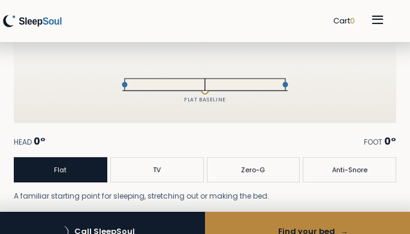

Live: [homepage `#articulation-demo`](http://127.0.0.1:3000/#articulation-demo) · [CRO PDP](http://127.0.0.1:3000/products/postureplus-4-5-cro/#articulation-demo) when `npm start` is running.

### Homepage — hero & brand

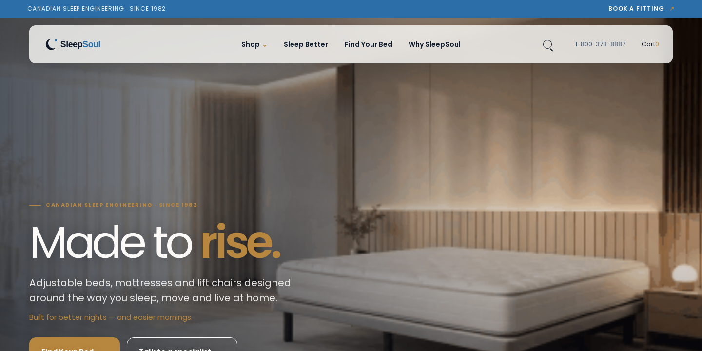

### Homepage — full scroll


### GSAP motion — scroll reveals & motion scene

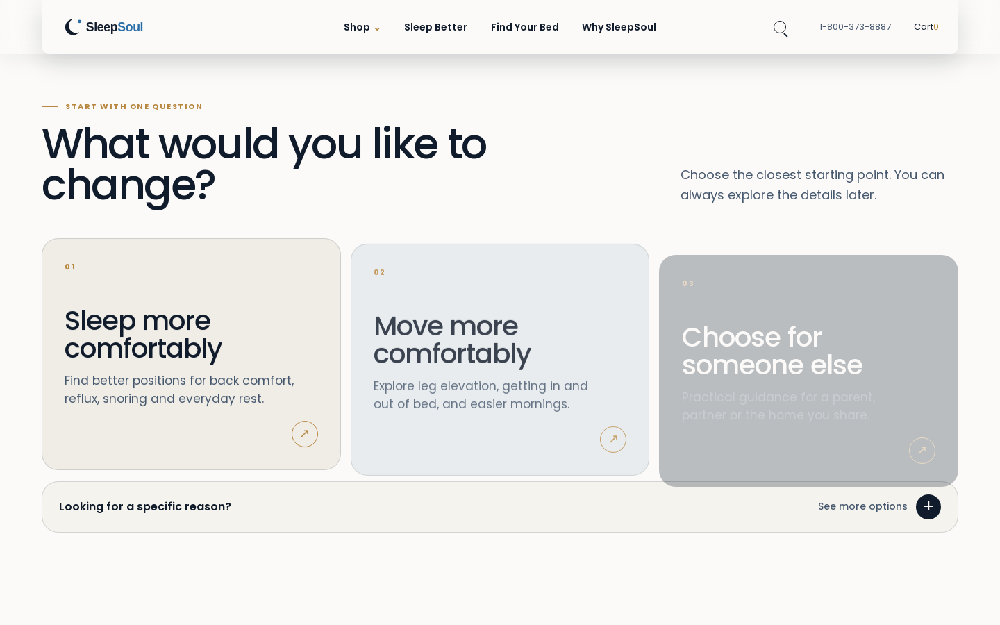

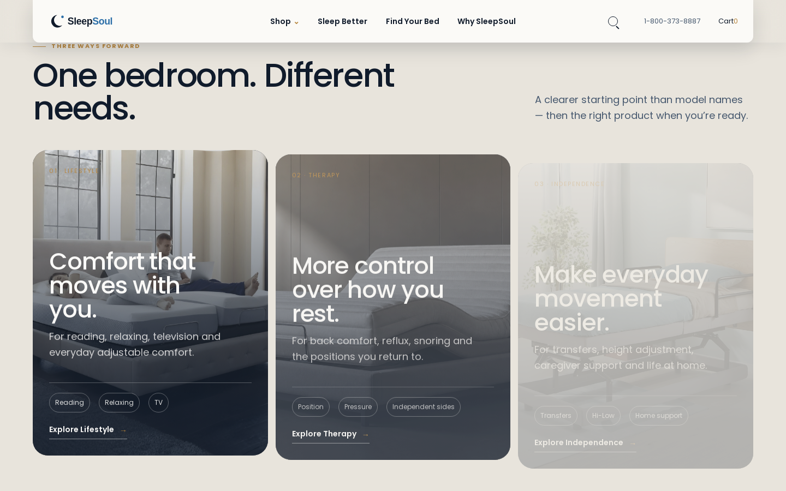

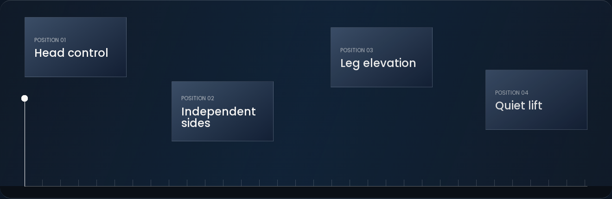

### Engineering & product education

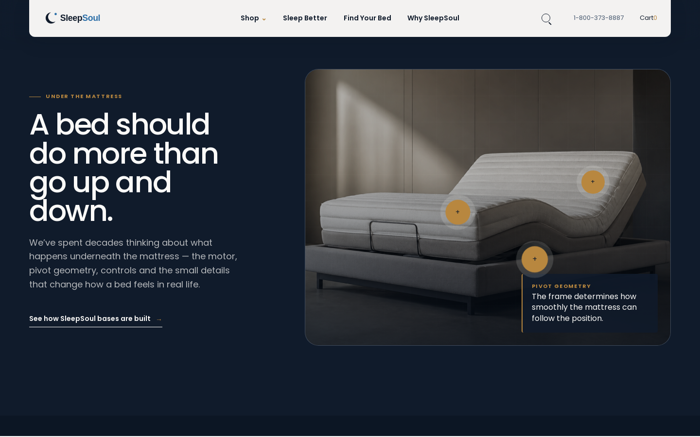

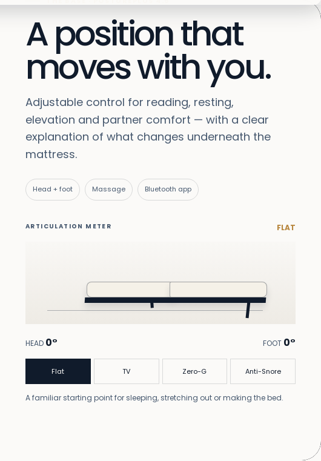

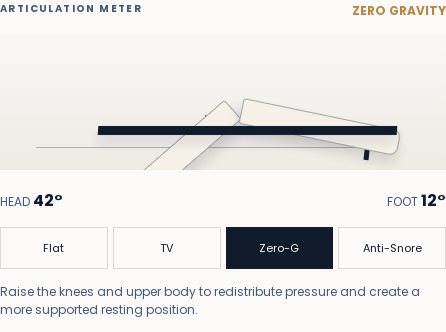

### Social proof & funnel pages

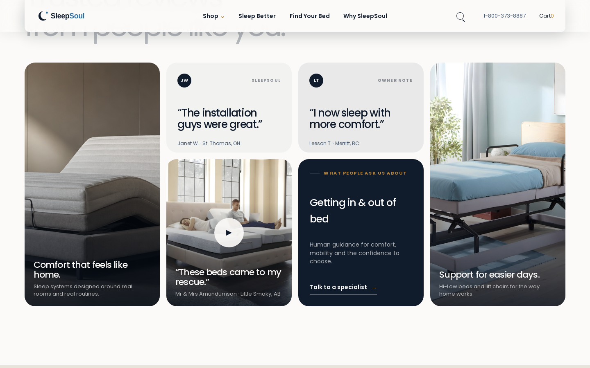

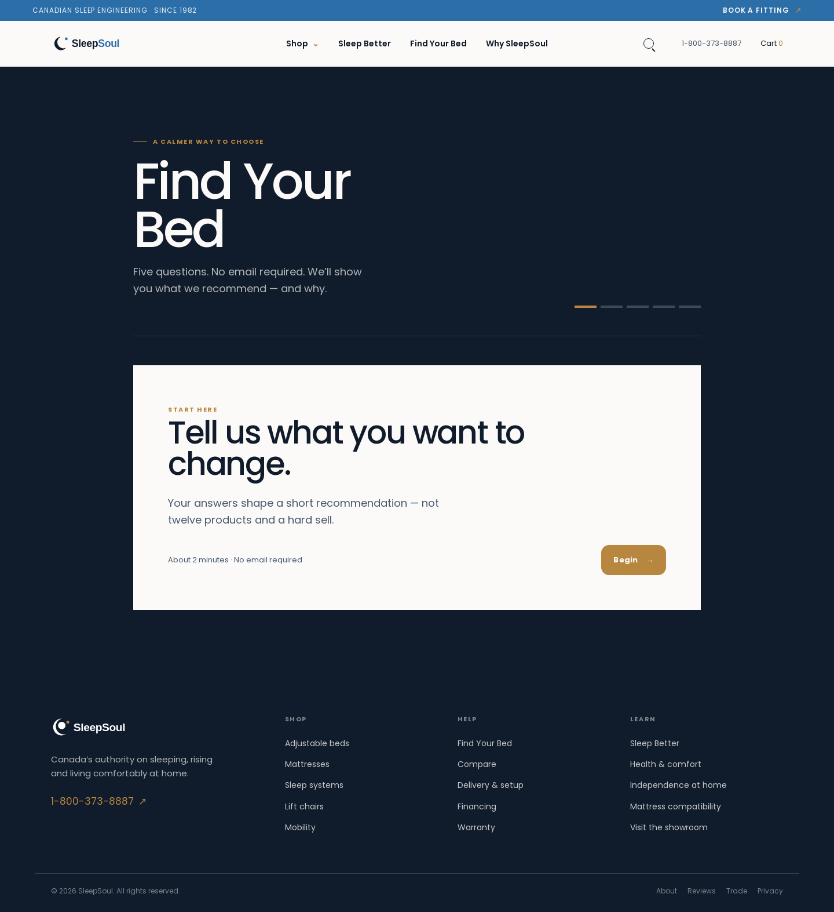

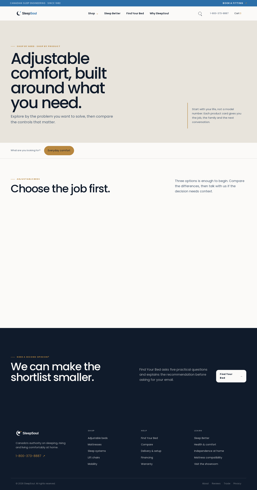

### Additional routes (smoke captures)

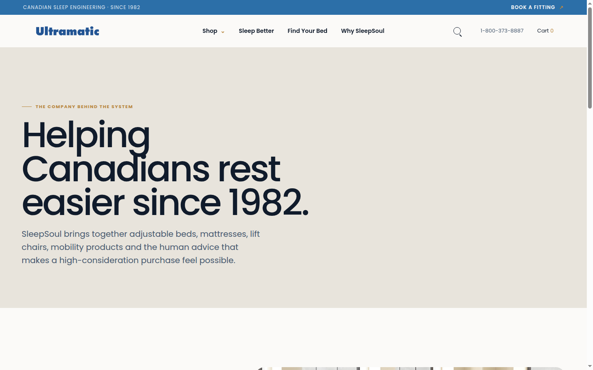

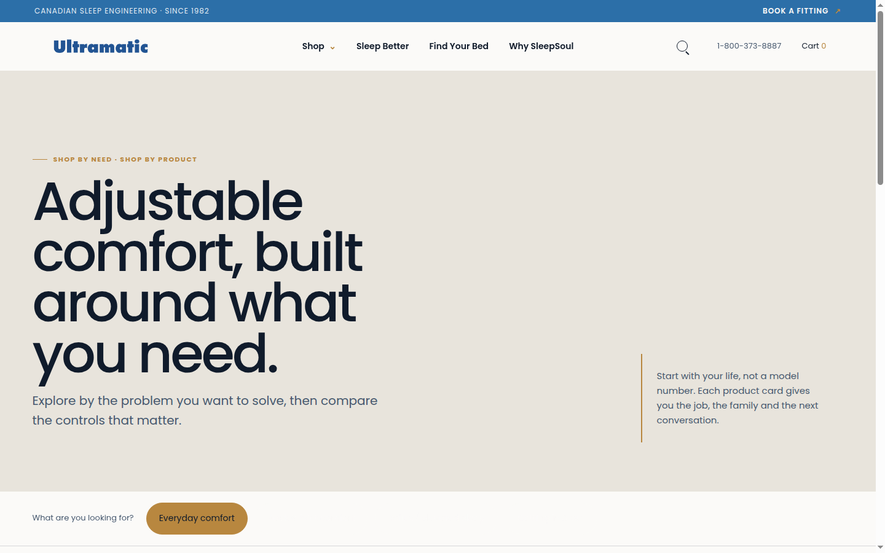

## Project structure

| Path | Purpose |
|------|---------|
| `index.html`, `*/index.html` | Published pages |
| `site-template.html`, `clone.js`, `clone.css` | Shared layout and homepage modules |
| `public/assets/` | Brand imagery and media |
| `scripts/` | Dev server, build, and QA scripts |
| `docs/research/` | Page specs and behavior notes |
| `docs/dossier/` | Full-page and interaction screenshots |
| `docs/screenshots/articulation-meter.gif` | Latest articulation preset loop (regenerate via script above) |
| `products/postureplus-4-5-cro/` | Conversion-focused PDP prototype |

## Commercial use

The SleepSoul **concept and theme** (copy structure, visual language, interaction patterns, and page set) may be licensed for your brand or product line. This repo is intended as a demonstrable, runnable package for evaluation—not an open-source drop.
